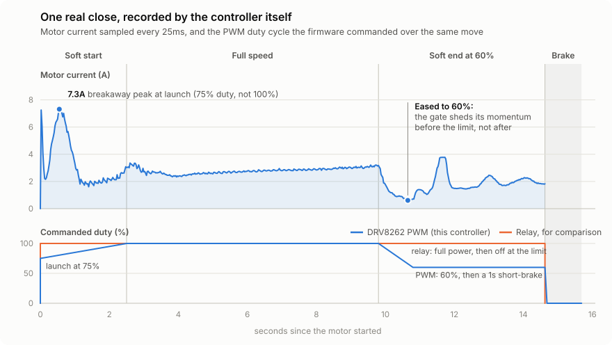
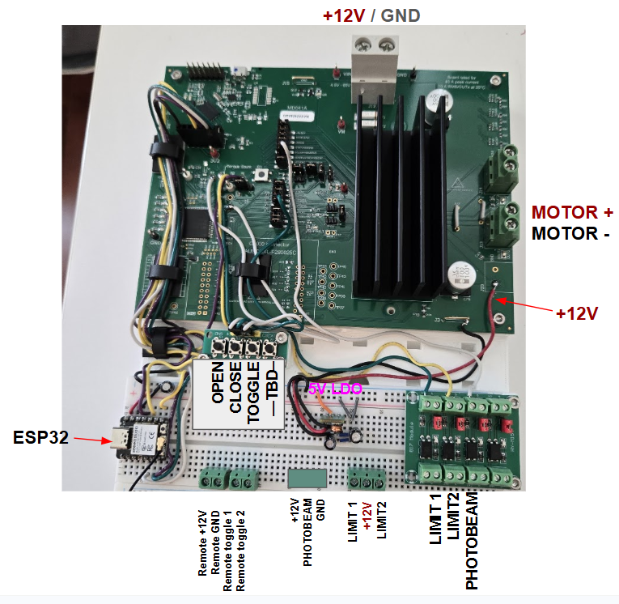
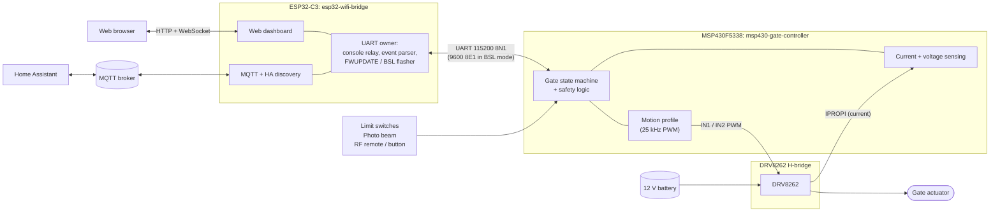
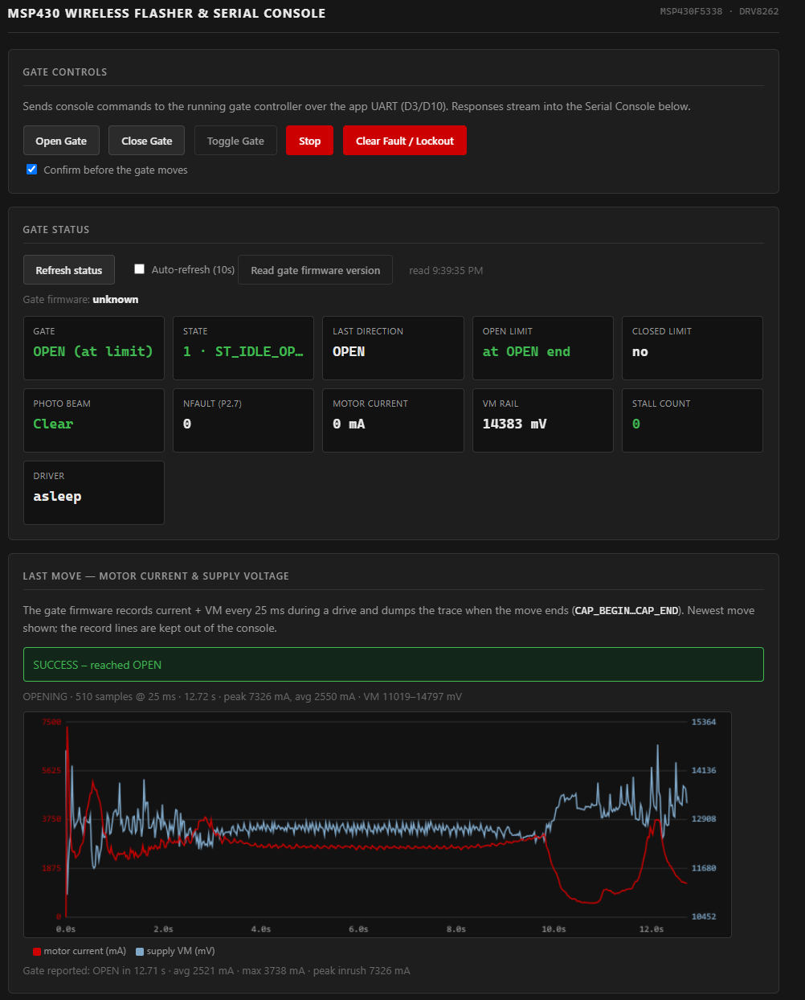

# DRV8262 DIY Swing Gate Controller

A swing-gate opener I built from scratch to replace a relay-based controller. It drives the gate's actuator with Texas Instruments' **DRV8262** integrated H-bridge, so every move has a soft start and a soft stop instead of full power until a limit switch cuts it off. An **MSP430** runs the gate and all of its safety logic. An **ESP32** adds a web dashboard, Home Assistant integration, and wireless firmware updates for both chips.

## Relay vs. PWM: same gate, same motor

<!-- 🎬 HERO GIF: a short, looping side-by-side of the last ~4 s of a close (see "Claude deleteme.md" → Video).
     Save as media/video/relay-vs-pwm-stop.gif (≤ 5 MB, ~720 px wide). It autoplays, so visitors see the difference without pressing play. -->

<!-- 🎬 FULL VIDEO: on github.com, edit this README and drag relay-vs-pwm-soft-stop.mp4 (≤ 10 MB) onto the editor.
     GitHub uploads it and inserts a https://github.com/user-attachments/assets/... link. Replace this whole comment
     with that link, alone on its line, and GitHub shows a video player here. -->

**Left: the original relay controller.** The motor runs at full power until the limit switch opens the relay. A heavy swing gate is still at full speed at that moment, so its momentum carries it about 1.5 ft too far, and it then oscillates slowly back into place. **Right: this controller.** Near the end of travel it eases the motor to 60%, winds down to zero at the limit, and holds the arm with a one-second short-brake. The gate arrives slowly and stops at the limit, with almost no overshoot.

## Why an integrated H-bridge instead of relays

A relay is either on or off. The DRV8262 switches the motor with MOSFETs at 25 kHz, so the firmware can set any speed from 0 to 100% and change it gradually. That makes the soft stop possible, and it also brings current sensing and protection built into the same chip.

<picture>
  <source media="(prefers-color-scheme: dark)" srcset="media/charts/pwm-close-profile-dark.svg">
  
</picture>

*A real close, recorded by the controller itself (it captures current and voltage every 25 ms during every move). [Raw data](media/data/close-2026-09-28.csv) · [chart script](tools/plot_capture.py)*

| | Relay control | DRV8262 PWM (this project) |
|---|---|---|
| **Speed** | Full power or off | Anything from 0 to 100%, changed smoothly |
| **Starting** | Full voltage at once: an inrush spike, a jerk, and a sag on the battery | Launches at 75% and ramps to 100% over 2.5 s |
| **Stopping** | Power is cut at the limit switch while the gate is still at full speed. On this gate that meant coasting about 1.5 ft too far, then oscillating back into place | Eases to 60% before the limit, winds to zero, then short-brakes the motor to hold the arm: almost no overshoot |
| **Current sensing** | Needs an added shunt resistor and amplifier, or a Hall sensor | Built in: the IPROPI pin outputs a copy of the motor current, so an ADC pin and a resistor are all it takes |
| **Over-current protection** | A fuse | The chip's own current regulation and shutdown, plus two firmware trip levels |
| **Obstacle detection** | Needs extra hardware | The same current signal: a jump while closing means something is in the way, so the gate reverses |
| **Reversing direction** | Two relays or a DPDT, timed so they never short the supply | Two logic pins, with shoot-through protection in the chip |
| **Wear and noise** | Contacts arc on every DC motor break, and they click | Solid-state and silent (25 kHz is above human hearing) |

Every step of that motion profile is a runtime setting (`SET_SOFT_END_CLOSE 9500`, `SAVE`), so tuning it for a different gate takes a web form, not a recompile.

## The build

*The DRV8262VEVM (top) carries the DRV8262 under its heatsink and the MSP430F5338. The breadboard (bottom) holds the ESP32-C3, test buttons, a 5 V regulator, and the terminal blocks and input module for the limit switches, photo beam and RF-remote receiver.*

<!-- 📸 PHOTO: the finished controller installed in its enclosure at the gate post (door open, wiring visible).
     Save as media/hardware/installed-enclosure.jpg. Landscape, ~1600 px wide, JPG under ~500 KB. -->
<!-- 📸 PHOTO: the gate itself with the actuator arm, photo-beam posts and enclosure all in frame.
     Save as media/hardware/gate-overview.jpg. -->

  
  

The base is TI's **DRV8262VEVM** evaluation module, in the DDV package variant: the driver's thermal pad is on *top* of the chip, so the heatsink clips straight onto it instead of the heat going out through the board. The EVM already carries an MSP430F5338, which became the gate's controller. The gate runs on a 12 V battery.

## What it does

- **Soft start and soft stop on every move**, as shown above.
- **Obstacle reversal while closing**, from either a current spike or the photo beam. **Halt and back off while opening**, since an obstacle on the way open is almost always the arm reaching its mechanical stop.
- **Three levels of over-current protection**: a firmware soft trip that ignores the launch surge, a firmware hard trip that is always armed, and the DRV8262's own hardware limit.
- **Safety checks that don't need the network**: stall timeout, a check that the starting limit switch actually releases, a lockout if both limit switches read active at once, low-battery lockout with hysteresis, and driver-fault recovery. The MSP430 handles all of these by itself.
- **Photo-beam vehicle detection.** Every beam break is timed to ±10 ms and classified as a car, a person or animal, or a long block. Home Assistant uses that to close the gate right after a car goes through.
- **Per-move health data.** Travel time, average and peak current, and inrush for every move, plus a full 25 ms current/voltage capture. Current creeping up over weeks is an early warning for a sticking hinge or a worn actuator.
- **Sleeps between ticks**: a 1 ms control loop while moving, 10 ms at rest, and the motor driver powered down between moves. The serial console still answers at any time.
- **25 runtime-tunable parameters**, saved in the MSP430's flash, adjustable from the dashboard.
- **Pushes events instead of being polled.** A state change reaches Home Assistant in about 0.23 s (it used to take 1.4 s).
- **Wireless firmware updates for both chips**, including the MSP430, whose ROM bootloader entry doesn't work on this board. [How →](#the-hard-part-an-msp430-that-wouldnt-enter-its-bootloader)

## Architecture

The split is deliberate. The MSP430 owns everything real-time and everything safety-related, and it works the same with the ESP32 unplugged. The ESP32 is a service layer: if Wi-Fi drops or the bridge reboots, the gate doesn't notice.

## Web dashboard

<!-- 📸 SCREENSHOT: dashboard top section (controls + status tiles). Save as media/screenshots/web-dashboard.png
     📸 SCREENSHOT: the "Last Move" current/voltage chart card after a close. Save as media/screenshots/web-last-move-chart.png -->

  
  

The ESP32 serves a single-page dashboard: gate controls, live status, the current/voltage chart of the last move, the full parameter table with per-row set and reset, a live serial console, and firmware upload for both chips. More in [`esp32-wifi-bridge/`](esp32-wifi-bridge/).

## The hard part: an MSP430 that wouldn't enter its bootloader

MSP430s normally take new firmware through the ROM bootstrap loader: hold `TEST`, pulse `RST`, and the chip listens for a flashing protocol. On this board's MSP430F5338 that entry sequence never works. That was a problem, because the gate is at the end of the driveway and a wired debugger isn't.

So the **running gate firmware updates itself**. You drop a new image onto the ESP32's web page. The ESP32 sends `FWUPDATE`, and the MSP430 copies a small updater into RAM, stops the gate application, and takes the image over its normal serial console in CRC-checked frames, acknowledging each one. It rewrites its own flash segment by segment (leaving the saved settings alone) and reboots into the new build. The ESP32 also has the standard BSL entry paths as fallbacks for boards where they do work, and it updates itself over Wi-Fi through a two-slot OTA partition table. Full write-up: [`esp32-wifi-bridge/README.md`](esp32-wifi-bridge/README.md#the-hard-part-flashing-an-msp430-whose-bootloader-doesnt-work).

## Measured

| | Result |
|---|---|
| Home Assistant command → `moving` shown in HA | **234 ms** mean (was 1362 ms with polling) |
| Firmware's share of that | 0–4 ms. The rest is the Wi-Fi/MQTT round trip |
| Bridge reboot → correct state back in HA | ~2 s |
| Current capture per move | 1024 samples × 25 ms: current and battery voltage |
| Photo-beam edge timing | ±10 ms |
| Host-side tests | Build the real `beam.c` and the bridge's real parsers on a PC, and check both firmwares agree on every field of the serial protocol ([`tests/`](tests/)) |

Details: [`docs/test-results-2026-09-28.md`](docs/test-results-2026-09-28.md).

## Repository layout

| Folder | What's in it |
|---|---|
| [`msp430-gate-controller/`](msp430-gate-controller/) | The gate firmware: state machine, motion profile, current sensing, safety logic. A Code Composer Studio project |
| [`esp32-wifi-bridge/`](esp32-wifi-bridge/) | ESP32-C3 firmware: web dashboard, MQTT/Home Assistant, wireless flashing. A PlatformIO project |
| [`home-assistant/`](home-assistant/) | Entity reference and the gate automations |
| [`tests/`](tests/) | Host-side tests that cross-check the two firmwares' serial protocol |
| [`tools/`](tools/) | `plot_capture.py`: turns a move capture into the chart above |
| [`docs/`](docs/) | Write-ups: the switch from polling to pushed events, and its test results |
| `media/` | Photos, screenshots, charts, video |

## Home Assistant integration and gate automations

<!-- 📸 SCREENSHOT: your HA dashboard card(s) for the gate (cover tile, moving/beam/limits, last-move history graph).
     Save as media/screenshots/ha-dashboard.png. Phone-width (≈ 400 px) looks good next to the device page. -->
<!-- 📸 SCREENSHOT: HA device page for "MSP430 Gate Controller". Save as media/screenshots/ha-device-page.png -->

  
  

The bridge registers itself with MQTT discovery as one device, **MSP430 Gate Controller**, with a `cover` and 28 more entities: limit switches, photo beam, a beam-activity event (`vehicle_pass` / `short_break` / `long_block`), live current and battery voltage, per-move health stats, a cycle counter, open/close/stop buttons, and bridge diagnostics. No YAML is needed on the Home Assistant side.

On top of that, two automations run the gate day to day:

The main rule: the firmware treats *any* command during a move as "stop now", so the automations never press a button while the gate is moving. Every close is also re-checked (beam, camera zone, hold-open switch) immediately before the button press. In a replay against 10 days of real traffic, the new logic would have cut the median time the gate stands open from 3.5 minutes to under one. The generalized YAML, a placeholder-to-entity table, and flowcharts for each branch are in [`home-assistant/`](home-assistant/).

## Safety note

This is a personal project, and it hasn't been certified to UL 325 or any other gate-operator standard. Automatic gates can crush and kill. The obstacle reversal here is a backstop, not something to rely on: keep people and pets clear of a moving gate, test the reversal regularly, and if you build something like this, give it a photo beam at the very least.

## License

MIT. See [`LICENSE`](LICENSE).
