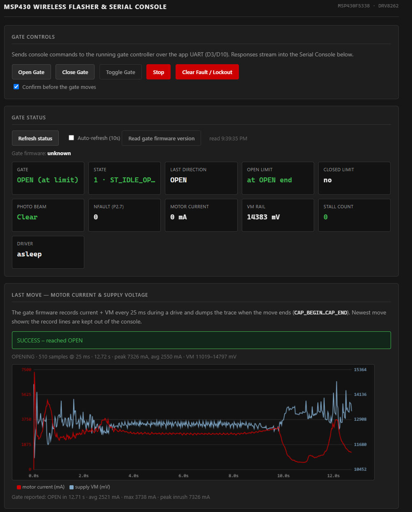

# ESP32 Wi-Fi bridge: dashboard, Home Assistant, wireless flasher

A Seeed Studio XIAO ESP32-C3 wired to the gate controller's serial port. It gives the MSP430 a Wi-Fi presence:

- a **web dashboard**: gate controls, live status, a current/voltage chart for every move, a settings editor and a serial console
- **Home Assistant** integration over MQTT, with auto-discovery (a `cover` plus 28 more entities)
- **wireless firmware updates** for the MSP430 *and* for itself

It's one ESP-IDF C++ file ([`src/main.cpp`](src/main.cpp), ~4k lines including the embedded web page), built with PlatformIO.

<!-- 📸 SCREENSHOT: full web dashboard, top of page (Gate Controls + Gate Status tiles + Last Move chart).
     Browser at ~1200 px wide, gate idle at the CLOSED limit, right after a move so the chart has data.
     Save as media/screenshots/web-dashboard.png -->


## Dashboard tour

| Section | What it does |
|---|---|
| **Gate Controls** | Open / Close / Toggle / Stop / Clear Fault, with an optional "confirm before moving" switch |
| **Gate Status** | Tiles for state, both limits, photo beam, motor current, battery voltage, stall count, driver fault, firmware version |
| **Last Move** | Motor current and supply voltage over the whole move, drawn from the capture the MSP430 dumps after every move |
| **Gate Settings** | All 25 tunable parameters in 6 groups, each with its unit, range and a one-click reset to default, plus an "unsaved changes" banner until you `SAVE` |
| **Serial Console** | Live, color-coded MSP430 console over WebSocket. Type any command, or download the log |
| **Firmware** | Upload a TI-TXT image to reflash the MSP430, or a `firmware.bin` to update the ESP32 itself |
| **ESP32 Status** | Wi-Fi network, RSSI, IP, uptime, free heap, chip temperature |

<!-- 📸 SCREENSHOT: the Last Move chart card on its own, after a normal close. Crop tight to the card.
     Save as media/screenshots/web-last-move-chart.png -->
<!-- 📸 SCREENSHOT: Gate Settings table with one group expanded (e.g. "Soft end-of-travel").
     Save as media/screenshots/web-settings.png -->

## The hard part: flashing an MSP430 whose bootloader doesn't work

MSP430s normally take new firmware through the ROM bootstrap loader (BSL): hold `TEST`, pulse `RST`, and the chip listens at 9600 8E1. Every app note assumes that works. On this board's MSP430F5338 it doesn't. The hardware entry sequence never latches, so the standard path was a dead end, and the gate is at the end of the driveway, not on a bench next to a debugger.

**The fallbacks, still in the code.** Two attempts remain for boards where they do work: a hardware `RST`/`TEST` entry sweep that tries several timings and auto-detects swapped TX/RX wires, and a *software* BSL entry (the running app jumps to the BSL at 0x1000 on command). They're reasonable first things to try on another board.

**What actually works: `FWUPDATE`.** The gate application updates itself:

1. You drop a TI-TXT image (Code Composer Studio's hex output) onto the web page. The ESP32 parses it and buffers the image in RAM.
2. The ESP32 sends `FWUPDATE`. The MSP430 copies a small updater into RAM, halts the application and answers `0xCC` (ready).
3. The ESP32 streams the image as frames of `0xA5, addr, len ≤ 128, data, CRC-16`. The MSP430 erases each 512-byte flash segment on first write, writes the frame, verifies it, and answers `0x06` (ACK) or `0x15` (NAK → resend).
4. A final `0x5B` commits, and the MSP430 resets into the new firmware.

A progress bar in the browser tracks it. Only main flash is rewritten, so the tuned parameters in info flash survive every update. When the new firmware boots, its `VERSION` line (build date and time) shows up on the dashboard and in Home Assistant, so you can see which build is running.

**One UART, two personalities.** The ESP32-C3 uses one UART peripheral for both jobs. Normally it's the application console at 115200 8N1 on one pin pair. For a BSL session it switches to 9600 8E1 and moves to a second pin pair, the MSP430's BSL pins, which double as LED lines on the EVM the rest of the time (so they're never driven outside a BSL session). `enter_bsl()` / `set_uart_mode()` / `bsl_uart_attach()` handle the switch.

**One reader, many writers.** One task, `uart_rx_task`, owns the UART receive side. It splits the stream into `;`-terminated messages, parses the MSP430's pushed `EVT` lines for MQTT, pulls out the per-move capture for the chart, and forwards everything else to the browsers. Every writer (web console, MQTT commands, NTP time sync) goes through one mutex-guarded `app_uart_write()`, so nothing interleaves mid-command.

## Wiring (XIAO ESP32-C3 → DRV8262VEVM / MSP430F5338)

| XIAO pin | GPIO | MSP430 signal | Use |
|---|---|---|---|
| D3 | 5 | P8.3 UCA1RXD (pin 61) | App console, ESP32 → MSP430. Always connected |
| D10 | 10 | P8.2 UCA1TXD (pin 60) | App console, MSP430 → ESP32. Always connected |
| D4 | 6 | RST/NMI (pin 96) | Hardware reset and BSL entry. High-Z otherwise |
| D5 | 7 | TEST (pin 91) | BSL entry. High-Z otherwise |
| D6 | 21 | P1.2 BSL RX (pin 36) | BSL session only |
| D7 | 20 | P1.1 BSL TX (pin 35) | BSL session only |

Plus a common ground between the two boards.

## Setup

1. **Credentials.** Copy `src/secrets.example.h` to `src/secrets.h` and fill in Wi-Fi, MQTT broker and an OTA token. `secrets.h` is gitignored.
2. **First flash over USB:** `pio run -t upload`. This also writes the two-slot OTA partition table.
3. **After that, update over Wi-Fi:** set `custom_ota_host` in `platformio.ini` to the bridge's IP, then:
   ```powershell
   $env:GATE_OTA_TOKEN = "<same value as OTA_TOKEN>"
   pio run -e ota -t upload
   ```
   Or upload `.pio/build/seeed_xiao_esp32c3/firmware.bin` from the dashboard's Firmware card.
4. **Home Assistant** finds the device on its own once the broker settings are right. See [`../home-assistant/`](../home-assistant/).

If the home Wi-Fi can't be reached within 30 s, the bridge also starts its own access point (`MSP430_Flasher`, dashboard at `http://192.168.4.1/`) and keeps retrying the home network in the background. It's never stuck in fallback mode.

The ESP-IDF 6.x build pulls `espressif/mqtt` as a managed component on the first build (needs internet once).

## Interfaces

| Endpoint | Purpose |
|---|---|
| `GET /` | The dashboard (HTML/CSS/JS embedded in `main.cpp`, no build step) |
| `GET /ws` | WebSocket. Browser → bridge: `DATA:<text>` goes straight to the MSP430 console, `CMD:<name>` runs bridge actions (reset, BSL, time sync, …). Bridge → browser: console lines plus `PROGRESS:`, `TELEMETRY:`, `SYNCED:` sentinels |
| `POST /upload` | TI-TXT image → `FWUPDATE` to the MSP430 |
| `POST /ota?token=…` | ESP32 self-update into the spare OTA slot |

MQTT topics and entities are listed in [`../home-assistant/README.md`](../home-assistant/README.md). The original MQTT design notes are in [`docs/HOMEASSISTANT_MQTT_PLAN.md`](docs/HOMEASSISTANT_MQTT_PLAN.md).

> **Security.** Only the ESP32's own OTA endpoint checks a token. The dashboard, the WebSocket console and the MSP430 firmware upload are open to anyone on the network the bridge is on, and all of them can move the gate. Put it on a trusted network or an IoT VLAN, and don't port-forward it.

## Other details

- **NTP time sync.** The bridge sends `TIME:<epoch>` to the MSP430 at boot and every 30 min, so the gate's log lines carry real timestamps.
- **Legacy fallback.** If the MSP430 is running an older build that doesn't push events (detected from its `STATUS` reply), the bridge falls back to polling every 2 s, so updating the two boards in either order won't break Home Assistant.
- **Retained vs. not.** State topics are retained so Home Assistant has correct values right after a restart. The beam-activity *event* topic is not, since a retained event would replay on every restart and re-fire automations.
- **Diagnostics are change-gated.** RSSI (to the nearest 5 dBm), free heap and chip temperature publish only when they change, so they don't flood Home Assistant's history.
