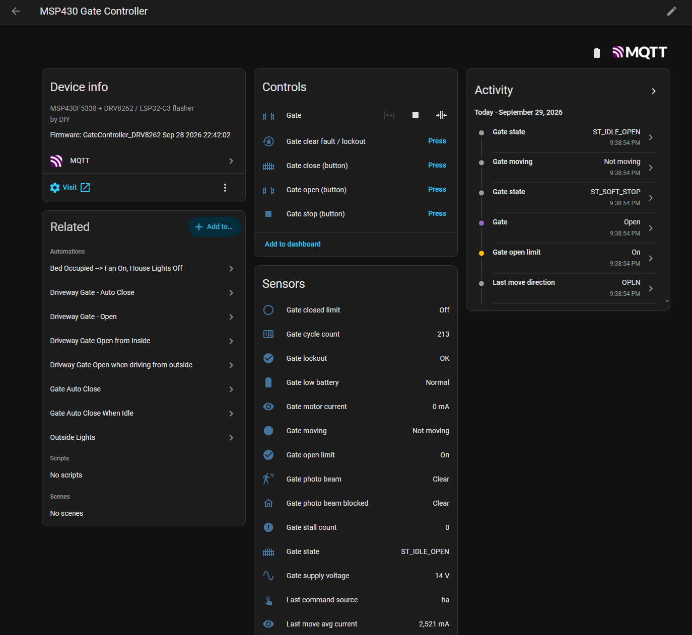
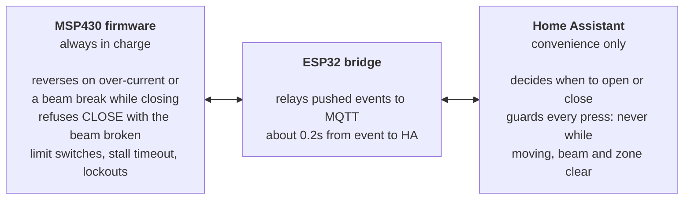
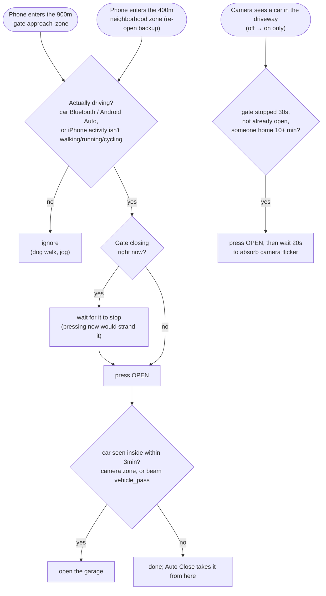
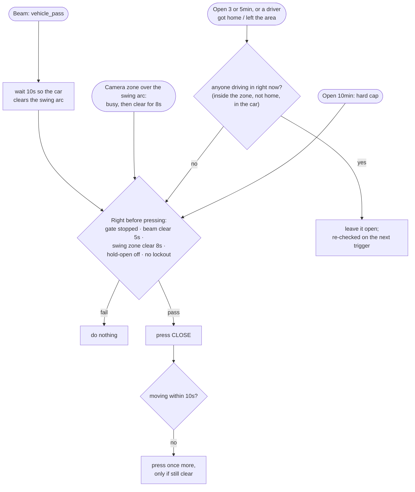

# Home Assistant integration

The ESP32 bridge registers the gate with Home Assistant through **MQTT discovery**. You don't need any YAML for the entities: point the bridge at your broker (`src/secrets.h`) and a device called **MSP430 Gate Controller** appears with 29 entities. This folder adds the part discovery can't: the automations that decide *when* the gate opens and closes.



## Three layers, one authority



The safety logic lives in the MSP430 and works with no network at all. Home Assistant only *requests* moves, and the automations are written so they would be safe even if the firmware weren't there to catch a bad request. They shouldn't need it to.

## Entities

Entity IDs below are what Home Assistant generated on my install. Yours should match, since they come from the discovery `object_id`.

| Entity | Type | What it is |
|---|---|---|
| `cover.msp430_gate_controller_gate` | cover (`device_class: gate`) | Open / close / stop. State is `open`, `closed`, `opening`, `closing` or `stopped` |
| `binary_sensor.…_gate_open_limit` / `…_gate_closed_limit` | binary_sensor | The two limit switches. **This is what the automations use for position** (see the note below) |
| `binary_sensor.…_gate_moving` | binary_sensor (`moving`) | On while the motor is driving, ramping or reversing |
| `binary_sensor.…_gate_photo_beam_blocked` | binary_sensor (`occupancy`) | Published on every beam edge, no latching. Attributes: last break length, breaks in the last 10s, chatter flag |
| `event.…_gate_beam_activity` | event | One event per beam "window": `vehicle_pass`, `short_break` (person, dog) or `long_block` |
| `sensor.…_last_command_source` | sensor | What started the last move: `ha`, `remote`, `wired_button`, `auto_reverse`, `obstruction_stop`, `fault`, `boot` |
| `binary_sensor.…_gate_lockout` | binary_sensor (`problem`) | Fault lockout (both limits active, repeated stalls, driver fault). Reason in the attributes |
| `binary_sensor.…_gate_low_battery` | binary_sensor (`battery`) | Battery below the cutoff. New moves are blocked, and a move already under way finishes |
| `sensor.…_gate_motor_current` / `…_gate_supply_voltage` | sensor | Live motor current (mA) and battery voltage (V) |
| `sensor.…_last_move_travel_time` / `_avg_current` / `_max_current` / `_peak_inrush` / `_direction` / `_completed` | sensor | Per-move health. **Trend these.** Travel time and current creeping up is the early warning for a binding hinge or a failing actuator |
| `sensor.…_gate_cycle_count` | sensor (`total_increasing`) | Completed moves, stored in the ESP32's NVS so it survives reboots |
| `sensor.…_gate_state` / `…_gate_stall_count` / `…_gate_photo_beam` | sensor | Raw state-machine state (`ST_*`), stall counter, beam as `Clear`/`Blocked` text |
| `button.…_gate_open_button` / `_close_button` / `_stop_button` / `_clear_fault_lockout` | button | One-shot commands |
| `sensor.…_bridge_wi_fi_rssi` / `_uptime` / `_free_heap` / `_chip_temperature` | sensor (diagnostic) | ESP32 health |

> **Why the automations read the limit switches instead of the cover.** With no position topic, Home Assistant's MQTT cover turns a `stopped` payload into `closed` if the last motion was closing. A gate stopped halfway while closing would read as closed. The two limit-switch sensors have no such ambiguity: if the closed limit is off, the gate is not closed.

<details>
<summary><b>MQTT topics</b> (if you'd rather not use discovery)</summary>

| Topic | Retained | Payload |
|---|---|---|
| `msp430gate/availability` | yes | `online` / `offline` (MQTT last will) |
| `msp430gate/state` | yes | JSON: `state`, `state_name`, `cover_state`, `moving`, `low_batt`, `open_limit`, `closed_limit`, `beam_broken`, `nfault`, `current_ma`, `vm_mv`, `stall_count`, `driver_asleep`, `last_dir`, `lockout`, `cmd_src`. Published on every change and at least every 30s |
| `msp430gate/beam` | yes | `ON` / `OFF` on every beam edge |
| `msp430gate/beam/attr` | yes | `{"last_break_ms":…,"last_edge_uptime_ms":…,"breaks_last_10s":…,"chatter":…}` |
| `msp430gate/beamact` | **no** | `{"event_type":"vehicle_pass",…}`. Not retained on purpose: a retained event would replay on every HA restart and re-fire automations |
| `msp430gate/lastmove` | yes | `{"dir":"OPEN","travel_ms":…,"avg_ma":…,"max_ma":…,"peak_ma":…,"cycles":…,"ts":"…"}` |
| `msp430gate/esp` | yes | Bridge diagnostics: `rssi`, `uptime_s`, `free_heap`, `temp_c` |
| `msp430gate/diag/beam_edges` | no | Raw per-edge timing, for tuning the vehicle classifier (no entity) |
| `msp430gate/cmd` | subscribe | `OPEN` / `CLOSE` / `TOGGLE` / `STOP`. Ignored while a firmware update owns the UART |

</details>

## Push, not poll

The first version of the bridge asked the MSP430 for `STATUS` every 8s. A move started from the RF remote showed up in Home Assistant 2.8 to 5.8s late, and short beam breaks either vanished or came through as exactly 8.1s long. On 2026-09-28 both firmwares switched to push: the MSP430 prints an `EVT` line in the same control-loop pass as the event, and the bridge publishes it straight from the parser.

| Measured on the live gate | Poll (before) | Push (after) |
|---|---|---|
| HA command → `moving: on` in HA | 1362ms | **234ms** mean (87–372ms, 6 runs) |
| Firmware's own share of that | up to 50ms | **0–4ms** (the rest is Wi-Fi/MQTT) |
| RF-remote move → shows in HA | 2.8–5.8s | not measured yet (pushed the same way) |
| Bridge reboot → correct state in HA | not measured | **~2s** |
| UART traffic with the gate idle | a poll every 8s | **none** (event lines + a 5-min heartbeat) |

Full write-up: [`docs/realtime-events-2026-09-28.md`](../docs/realtime-events-2026-09-28.md) and [`docs/test-results-2026-09-28.md`](../docs/test-results-2026-09-28.md).

## The automations

Two automations, in [`automations/`](automations/). Paste each into a new automation's YAML editor and replace the placeholder entities (table at the bottom).

### Rules every automation here follows

1. **Never press a button while the gate is moving.** The firmware treats *any* command during a move as "stop now, mid-travel". An automation that presses OPEN while the gate is closing doesn't reverse it; it strands it halfway. Every press is behind a `moving: off` check, and the arrival path waits for a closing gate to finish before opening it.
2. **Position comes from the limit switches**, never from the cover state (see above).
3. **Triggers fire on `off → on` only**, so a camera or integration restart (`unavailable → on`) can't open the gate. A Frigate restart at midnight did exactly that once.
4. **Check safety immediately before pressing**, not only when the automation starts. The close path re-checks beam, camera zone, hold-open and `moving` after its delays.
5. **Retry once, then give up.** If a CLOSE press doesn't produce motion within 10s, it tries one more time if everything is still clear, and after that it leaves the gate alone.

### Driveway Gate: Open ([`driveway_gate_open.yaml`](automations/driveway_gate_open.yaml))



The 900m passive zone gives 40 to 130s of warning at street speed, enough for a ~14s gate to be fully open before the car gets there. The "actually driving" check is what separates arriving home from walking the dog past the zone boundary.

### Driveway Gate: Auto Close ([`driveway_gate_auto_close.yaml`](automations/driveway_gate_auto_close.yaml))



At night the camera can't see the gate end of the driveway, so the photo beam's `vehicle_pass` event carries the "car went through" signal. The firmware classifies each beam window itself (one body-length break of 0.7 to 6s = vehicle; anything shorter = person or animal) and publishes one event per window. The `input_boolean.driveway_gate_hold_open` toggle pauses auto-close for parties and deliveries, and turns itself off the next time the gate reaches the closed limit.

### How it was tested

Before any of this went live, the logic was replayed against 10 days of Home Assistant recorder history: 90 real gate cycles, 67 after removing test bursts. Replay numbers are **estimates of what the new logic would have done**, not measurements yet:

| Over 10 days of real traffic | Old automations | New logic (replay) |
|---|---|---|
| Median time the gate stood open | 3.5min | under 1min |
| Cycles left open more than 10min | 20 of 67 | 0 (hard cap) |
| Total hours open | 22.7h | ~1.8h |
| Gate closes after a car leaves | ~3min (waited for phone GPS + 2min) | ~25s (camera or beam) |
| False opens (nobody arriving) | 6 | 1 |

### Two small hooks into other automations

- **Outside lights:** after dusk, the gate leaving the closed limit turns on the driveway floodlights the same way the garage door does. The camera only reliably spots cars at night once the floods are on.
- **Bedtime:** the "going to bed" automation closes the gate, behind the same guard (`closed_limit` off, `moving` off, beam clear).

```yaml
# Bedtime close, with the guard
- if:
    - condition: state
      entity_id: binary_sensor.msp430_gate_controller_gate_closed_limit
      state: "off"
    - condition: state
      entity_id: binary_sensor.msp430_gate_controller_gate_moving
      state: "off"
    - condition: state
      entity_id: binary_sensor.msp430_gate_controller_gate_photo_beam_blocked
      state: "off"
  then:
    - action: button.press
      target:
        entity_id: button.msp430_gate_controller_gate_close_button
```

### Adapting it to your setup

| Placeholder in the YAML | Replace with |
|---|---|
| `device_tracker.person_a_phone`, `device_tracker.person_b_phone` | Each driver's Companion-app GPS tracker (the phone itself, not the `person`) |
| `person.person_a`, `person.person_b` | The matching `person` entities |
| `binary_sensor.person_a_in_car` | Anything that's on only while that person is in their car. A template on the Android Companion app's `bluetooth_connection` sensor (car's Bluetooth MAC in `connected_paired_devices`) works well |
| `binary_sensor.person_a_phone_android_auto` | Android Companion app's Android Auto sensor (optional) |
| `sensor.person_b_phone_activity` | iOS Companion app activity sensor (`Automotive`, `Walking`, …) |
| `binary_sensor.driveway_middle_car_occupancy` | Camera zone between the house and the gate, car objects (Frigate) |
| `binary_sensor.driveway_exit_car_occupancy`, `binary_sensor.driveway_exit_all_occupancy` | Camera zone covering the gate's swing arc: cars only, and all objects |
| `cover.garage_door` | Your garage door, or delete that step |
| `zone.gate_approach` | Create it: passive, ~900m radius, centered on home |
| `zone.in_neighborhood` | Create it: ~400m radius |
| `input_boolean.driveway_gate_hold_open` | Create it (Settings → Helpers → Toggle) |

No camera? Delete the camera triggers and conditions. The beam's `vehicle_pass` and the timeouts still close the gate. No photo beam? Don't automate closing at all.

**Known limits:** a second car more than ~20s behind the first needs the remote. So does anyone riding in someone else's car, since there's no "in the car" signal for them.
