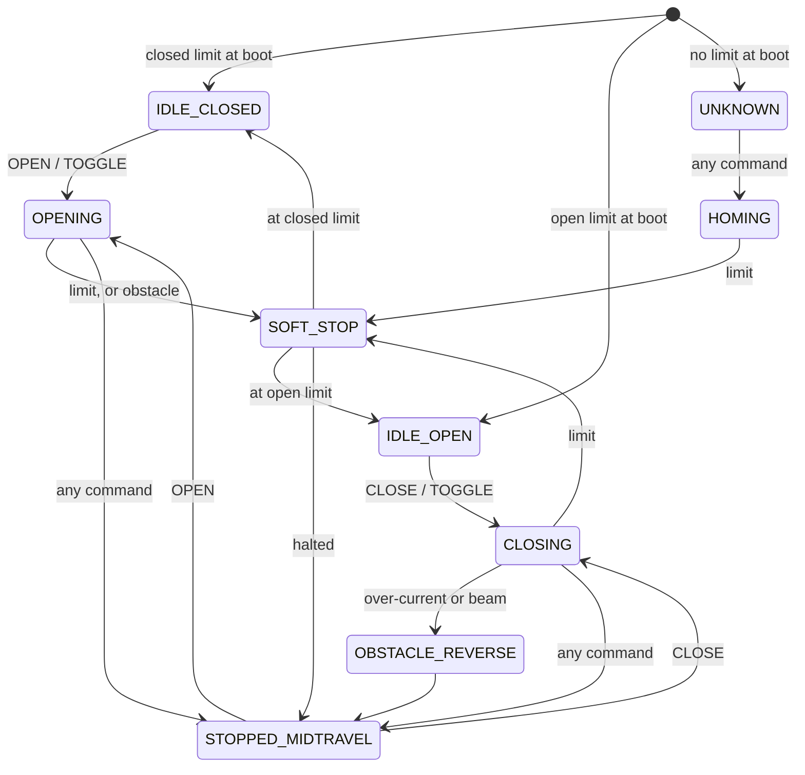

# Gate controller firmware: MSP430F5338 + DRV8262

This firmware runs the gate. One MSP430F5338 and one DRV8262 H-bridge drive a linear-actuator swing-gate arm from a 12 V battery. It reads a limit switch at each end of travel, a photo beam across the opening, and an RF-remote/wired toggle input. It runs standalone: the [ESP32 bridge](../esp32-wifi-bridge/) is an optional service layer on its serial port, and the gate works the same with nothing connected.

- **Toolchain:** Code Composer Studio (TI MSP430 compiler v21.6). This folder *is* the CCS project: *File → Import → Code Composer Studio → CCS Projects*, select this folder, build.
- **Hardware:** TI [DRV8262VEVM](https://www.ti.com/tool/DRV8262EVM) (DDV package), which carries both the DRV8262 and the MSP430F5338. Pin routing through the EVM's jumpers is in [`docs/PinoutGuide.md`](docs/PinoutGuide.md).
- **Talk to it:** 115200 8N1 on UCA1. Every command and reply is in [`docs/SERIAL_PROTOCOL.md`](docs/SERIAL_PROTOCOL.md).

## Motor control: PWM, not relays

The DRV8262 runs in single-H-bridge mode (both half-bridge pairs paralleled, 25 mΩ per side) with PWM IN/IN control from Timer_B0 at 25 kHz. Speed and direction are just two logic pins, so every move is shaped:

| Phase | What the firmware does | Why | Tunable |
|---|---|---|---|
| **Launch** | Starts at 75% duty, not 0% | Breaks the gate free right away, without the full-power inrush of a relay closing | `RAMP_START_DUTY` |
| **Soft start** | Slews 75% → 100% over 2.5 s | Keeps inrush and battery sag down while the gate builds speed | `RAMP_TIME`, `RUN_DUTY` |
| **Full speed** | 100% | | |
| **Soft end** | At 9.8 s into the move, eases down to 60% | The gate sheds its momentum *before* it reaches the limit. Under relay control, this gate coasted about 1.5 ft past the limit and oscillated before settling | `SOFT_END_OPEN`, `SOFT_END_CLOSE`, `SOFT_END_DUTY` |
| **Stop at the limit** | Winds the remaining duty to 0 over 100 ms, then short-brakes (IN1 = IN2 = 1: both high-side FETs on, shorting the motor) for 1 s | Braking straight from drive dumps the winding energy as a current spike. The short-brake then holds the arm still while it settles | `BRAKE_TIME` |
| **Rest** | Coast, then put the DRV8262 to sleep (~3 µA) | Battery | `IDLE_SLEEP` |

The soft-end point is time-based. Set it from the gate's measured travel time, which the controller reports after every move. The ramp is a Q8 fixed-point slew accumulator stepped from the 1 ms control tick (`drv8262.c`). The PWM hardware runs on its own, so no PWM interrupt is needed.

## Current sensing without a shunt

The DRV8262's **IPROPI** pins source a copy of the motor current (212 µA per amp) into the board's 3.3 kΩ sense resistors, which are paralleled to 1650 Ω in single-bridge mode. That is the entire current-sense chain: no shunt in the motor path and no amplifier, just one ADC12 channel. The ADC samples at 1 kHz with a trigger phase swept against the PWM period (so it never aliases onto the same point of the switching cycle), and averages 8 samples.

That one signal feeds:
- both over-current trips (below)
- the ~2 Hz drive-current progress lines and the per-move stats (average, max, peak inrush, travel time)
- a **per-move capture**: every 25 ms the controller records {mA, supply mV} into a 1024-sample RAM buffer and dumps it as CSV when the move ends. The bridge's web UI charts it, and [`tools/plot_capture.py`](../tools/plot_capture.py) turns it into the chart on the main page

## Safety behavior

- **Obstacle while closing: reverse.** An over-current trip *or* a photo-beam break while closing reverses toward open for 750 ms and then stops mid-travel to wait for a command. This follows the UL 325 idea used by commercial operators (the controller is not certified; see the main README).
- **Obstacle while opening: halt.** On the way open, an over-current is almost always the arm hitting its mechanical stop, not a person. So it ramps to zero, backs off 250 ms to unload the mechanism, and stops.
- **CLOSE is refused while the beam is broken.**
- **Three over-current tiers:**
  1. a *soft* trip (`OC_TRIP_CURRENT`), blanked for the first `OC_BLANK_TIME` of a move so the launch inrush doesn't trip it
  2. a *hard* trip (`OC_HARD_LIMIT`) that is checked every tick, including during blanking, to catch a locked rotor or short immediately
  3. the DRV8262's own hardware current regulation and over-current shutdown, reported on `nFAULT`

  The factory defaults are deliberately loose. Tune `OC_TRIP_CURRENT` to about 20% above your gate's real closing current, read from a capture.
- **Origin-limit check.** When a move starts from a limit switch, that switch must release within 2.5 s. If it doesn't, the motor leads are reversed, the actuator is jammed, or the switch is stuck, and the controller stops with a fault instead of driving into a hard stop.
- **Stall timeout.** A move that doesn't reach a limit within `MAX_DRIVE_DURATION` (16 s) faults. Five stalls in a row lock the controller out until it's power-cycled.
- **Dual-limit lockout.** Both limit switches active at once can't happen in a working install, so it locks out rather than guessing.
- **Low battery.** Below 10.8 V for 500 ms, new moves are refused until the battery recovers above 11.2 V. A move already under way finishes, so the gate is never left halfway because of a voltage dip.
- **Driver faults.** `nFAULT` is retried up to 3 times with a ~30 µs `nSLEEP` pulse, then locks out.
- **Current-sense watchdog.** On this chip, the Timer_A0 → ADC12 trigger chain occasionally freezes partway through a move (most likely an MSP430F5xx Timer_A/ADC12 erratum). While frozen, over-current protection would read stale current. If no fresh sample batch arrives within 30 ms, the firmware force-restarts the pipeline, so sensing is blind for at most ~30 ms. The full investigation is in the `ADC12_ISR` comments in `current.c`.

## State machine

The normal cycle (states are `ST_*` in `gate_types.h`):



`SOFT_STOP` covers the wind-down, the short-brake, and the opening-side backoff. The fault states sit outside that cycle:

| State | Entered when | Cleared by |
|---|---|---|
| `ST_STALL_FAULT` | A move runs past `MAX_DRIVE_DURATION` without reaching a limit | Any command: the gate homes slowly, away from the direction that stalled |
| `ST_LOCKOUT` | Both limits active, a driver fault that survives 3 retries, or 5 stalls in a row | Limits/driver: the condition gone for 2 s, then any command (which only clears, it doesn't move the gate). Repeated stalls: power cycle only |
| `ST_DRIVER_FAULT` | DRV8262 `nFAULT` while awake | `nFAULT` clearing (up to 3 `nSLEEP` pulse retries), then stopped mid-travel |
| `ST_LOW_BATTERY` | Battery under 10.8 V for 500 ms while at rest | Battery above 11.2 V for 2 s |

`gate_fsm.c` has the exact transitions.

"Any command while moving stops the gate" is deliberate: every input (wired button, RF remote, Home Assistant) doubles as an emergency stop. It's also why the [Home Assistant automations](../home-assistant/) never press a button while the gate is moving.

## Power

The control loop runs from a Timer_A2 tick and sleeps in **LPM0** in between: a 1 ms tick while the motor is moving, ramping or braking, and 10 ms at rest (<1% CPU duty). The earlier design was an always-on busy loop, and the estimate is roughly a 10× lower average draw (datasheet math, not yet measured on the bench). It uses LPM0 rather than the deeper LPM3 on purpose: LPM3 stops the clock the UART runs from, and the console has to answer at any time, including while the gate sits idle. The DRV8262 sleeps between moves, and the supply voltage is sampled once a second at rest for the low-battery check.

## Event reporting (for the bridge)

The controller pushes one-line events the moment something happens, in the same control-loop pass:

```
EVT MOVE_START dir=OPEN src=remote st=3 t=987654
EVT STATE st=3 lo=0 lc=0 bm=0 nf=0 slp=0 sc=0 dir=OPEN ma=1840 mv=12960 lk=0 dl=0 src=remote t=987654
EVT BEAM b=1 t=123456 dur=0 n10=1
EVT BEAMACT ev=vehicle_pass pat=body n=1 tot=1453 gs=1 t=123456789 brk=1453 gap=
```

`beam.c` times every photo-beam edge to ±10 ms and classifies each window: one break of 0.7 to 6 s is a `vehicle_pass`, anything shorter is a `short_break` (a person or a dog), and 6 s or more is a `long_block`. The classifier only observes. It reads the same debounced input the safety logic reads and never feeds back into it. At rest the UART is silent apart from these lines and a full `STATUS` block every 5 minutes as a heartbeat.

## Runtime-tunable parameters

25 parameters, including every threshold, duty cycle, ramp and timeout above, live in a versioned, range-checked table in `nvconfig.c`. They're stored in the MSP430's info flash (INFOD), so they survive reboots and firmware updates. Change them over the console:

```
LIST                      all params with value, unit and default
SET_SOFT_END_CLOSE 9500   RAM only, range-checked (cross-checked where order matters, e.g. soft < hard OC)
SAVE                      persist to flash
DEFAULTS                  back to factory values (then SAVE)
```

The bridge's web UI wraps this in a settings table with per-row set and reset buttons.

## Firmware updates without the ROM bootloader

The ROM BSL entry sequence never worked on this board's MSP430F5338, so the running application updates itself. `FWUPDATE` copies a small updater into RAM, then receives the new image over the normal console UART in CRC-16-checked 128-byte frames (ACK/NAK per frame, with resends), erasing each 512-byte flash segment on first write. It rewrites only main flash (0x8000–0xFFFF). The BSL area and the INFOD parameter block are never touched, so tuning survives an update. After a final commit byte it resets into the new image. Details are in `console.c` and in the [bridge README](../esp32-wifi-bridge/README.md#the-hard-part-flashing-an-msp430-whose-bootloader-doesnt-work).

> A power loss in the middle of an update leaves no bootable image, and recovering from that takes a wired debugger (MSP-FET). Update with the gate at the closed limit and the battery healthy.

## Files

| File | What it does |
|---|---|
| `main.c` | Init, then the super-loop: console → state machine → sleep until the next tick |
| `gate_fsm.c/.h` | The state machine above, motion profile, event lines |
| `drv8262.c/.h` | PWM, ramp, brake, sleep, fault clear, optional VREF DAC |
| `current.c/.h` | IPROPI + supply-voltage ADC, over-current inputs, per-move capture, stall watchdog |
| `inputs.c/.h` | Debounced limit switches, photo beam, buttons, RF remote; command queue with source tag |
| `beam.c/.h` | Photo-beam edge timing and vehicle/person classification (reporting only) |
| `console.c/.h` | Command parser, `;`-framed output, `FWUPDATE` RAM updater, software BSL entry |
| `nvconfig.c/.h` | The 25-parameter table, flash persistence |
| `board.c/.h` | Clocks, GPIO, dynamic tick, LEDs, uptime clock |
| `uart.c/.h`, `timesync.c/.h` | Interrupt-driven UART rings, wall-clock sync from the bridge (`TIME:<epoch>`) |
| `gate_config.h`, `gate_types.h` | Every constant and default, with the reasoning next to it |
| `docs/project_plan.md` | The Rev 3 design plan the firmware was built from, including the review feedback and how each point was resolved |
